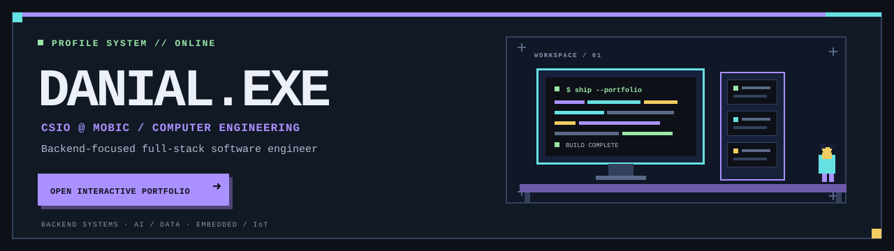

 

---

### `00 / PLAYER PROFILE`

> I'm the **Chief Software & Information Officer (CSIO) at MOBIC** and a **Computer Engineering undergraduate**. I work across software engineering leadership and IT strategy, with engineering interests in backend systems, enterprise software, intelligent technologies, embedded systems, and IoT.

- 🧭 **Leadership** — architecture, technical planning, delivery workflows, and aligning engineering with business requirements
- ⚙️ **Engineering** — API-driven, database-backed applications with FastAPI and ASP.NET Core
- 🧠 **Research** — NLP and corpus-based language tools; intelligent networks (ongoing)
- 🔌 **Hardware** — STM32, Arduino, ATmega, ARM-based systems, and sensor integration

---

### `01 / TECH INVENTORY`

**Backend & Languages** 

**Frontend** 

**Databases & Data** 

**AI & Embedded / IoT** 

| AREA | TOOLSET & FOCUS |
| :--- | :--- |
| Software and IT leadership | Architecture, technical planning, workflows, delivery, and IT strategy |
| Backend and systems | Python, FastAPI, C#, ASP.NET Core, REST APIs, SQL, relational and NoSQL databases |
| Full-stack development | Vue.js, JavaScript, TypeScript, HTML, and CSS |
| AI and research | PyTorch, machine learning, deep learning, and natural language processing |
| Embedded and IoT | STM32, Arduino, ATmega, ARM-based systems, embedded C/C++, and sensor integration |

---

### `02 / QUEST LOG — SELECTED BUILDS`

<table>
  <tr>
    <td width="50%" valign="top">
      <a href="https://github.com/Danial-EBR2002/Error-Graph"><b>🕸️ Error Graph</b></a> 
      Graph-first debugging platform for reconstructing failures across browser requests, APIs, services, and database errors.  
      
    </td>
    <td width="50%" valign="top">
      <a href="https://github.com/Danial-EBR2002/Spooky-Author-Attribution"><b>👻 Spooky Author Attribution</b></a> 
      BERT-based NLP classification of literary excerpts (~89% accuracy on the Spooky Author dataset).  
      
      
    </td>
  </tr>
  <tr>
    <td width="50%" valign="top">
      <a href="https://github.com/Danial-EBR2002/n-queen"><b>♛ N-Queens Visualizer</b></a> 
      Pygame visualizer with backtracking and genetic-algorithm solvers.  
      
    </td>
    <td width="50%" valign="top">
      <a href="https://github.com/Danial-EBR2002/Tank-battle"><b>🎯 BattleGrid · Tank Battle</b></a> 
      Turn-based Pygame tank duel on a 15×15 grid with items, a shrinking safe zone, and AI-controlled tanks.  
      
    </td>
  </tr>
  <tr>
    <td colspan="2" valign="top">
      <a href="https://github.com/Danial-EBR2002/Danial-EBR2002"><b>🖥️ DANIAL.EXE</b></a> — the interactive pixel-art portfolio behind this profile.
      <a href="https://danial-ebr2002.github.io/Danial-EBR2002/">Play it live →</a>  
      
    </td>
  </tr>
</table>

---

### `03 / RESEARCH LOG`

- 📚 *“The impact of linguistic data and corpus-based tools on teaching lexically ambiguous words to non-Persian speakers.”*
- 🌐 Ongoing research related to intelligent networks.

---

**Engineering reliable systems. Connecting software with technology strategy.**

[Portfolio](https://danial-ebr2002.github.io/Danial-EBR2002/) · [GitHub](https://github.com/Danial-EBR2002) · [Email](mailto:danialebrazeh@gmail.com) · [Portfolio guide](PORTFOLIO_SETUP.md)

